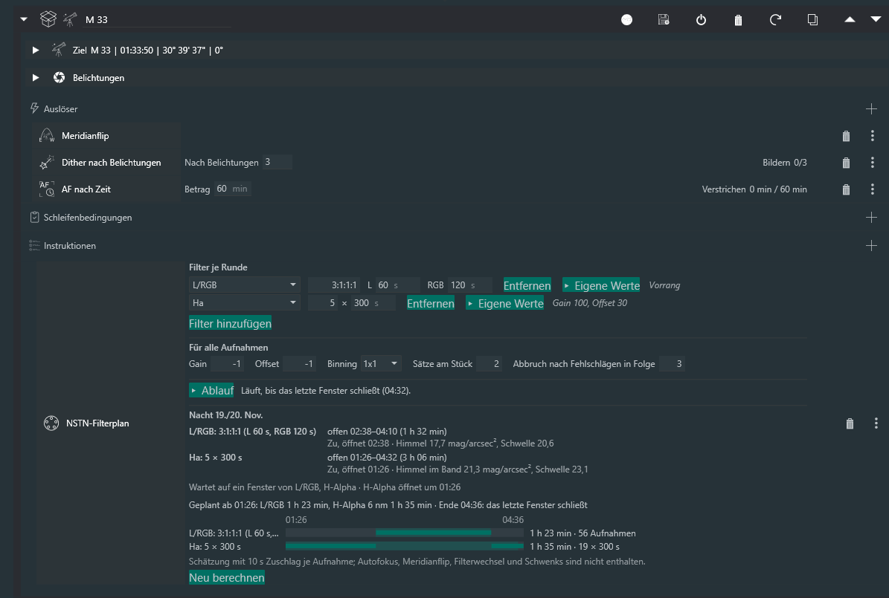
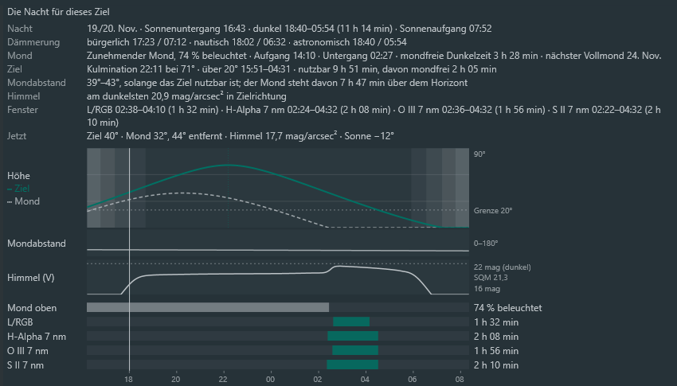

# NSTN for N.I.N.A.

**Narrowband Saves The Night**: a plugin for the Advanced Sequencer of
[N.I.N.A.](https://nighttime-imaging.eu/) that exposes each filter only while the sky makes it
worthwhile.

NSTN models the sky background towards your target over the whole night: light pollution of the
site (from its SQM value), twilight, and moonlight after Krisciunas & Schaefer, weighted per
emission line and bandwidth. A band is worth exposing while its in-band background stays darker
than a calibrated threshold. From that, NSTN derives a window per filter for tonight, and the
sequence follows those windows instead of fixed clock times. One sequence works in every night.

## Features

- **NSTN filter plan**: one instruction with a table, one row per filter. It waits for the
  first window, exposes each row while its window is open, round after round, and ends by
  itself when no window opens again this night, or at sunrise.
- **L/RGB row**: L, R, G and B in a ratio such as 3:1:1:1 (0 leaves a filter out), with one
  exposure time for L and one for R, G and B. The filters are found by their names.
- **Priority**: when a priority row's window opens, it takes over after the running exposure
  and nothing else runs while it is open. Of two open priority rows the upper one runs.
- **Own settings per row**: window (priority, threshold, minimum altitude, time span) and
  camera (gain, offset, binning; one set for L and one for RGB).
- **Night plan**: each row's window and the expected integration per filter.
- **NSTN Night Info**: twilight, moon, altitude of target and moon, their distance, the sky
  towards the target and tonight's windows per band, plus a check of the sequence structure.
- **Loop while NSTN window open** and **Wait for NSTN window**: the condition and instruction
  behind the filter plan, for building sequences by hand.
- Running exposures are always finished, never aborted. Triggers such as autofocus, dithering
  and meridian flip keep working, because the exposures are N.I.N.A.'s own instructions.
- English and German, following N.I.N.A.'s language setting.

## Requirements

- N.I.N.A. 3.2.0.9001. N.I.N.A. 3.3 nightly (3.3.0.1069) loads the same build, but was only
  checked in a test instance with simulators.
- Site latitude and longitude in the N.I.N.A. profile.
- A measured SQM value of the site (mag/arcsec²). A Bortle estimate is not enough.
- A filter wheel with a maintained filter list, for the filter plan.

## Installation

NSTN is not (yet) in N.I.N.A.'s plugin manager.

**Installer:** download `NSTN-Installer-<version>.zip` from the [Releases](../../releases),
close N.I.N.A., unpack the ZIP completely and run `Install-NSTN.cmd`. No administrator rights
are needed; it installs for the current Windows user into
`%LOCALAPPDATA%\NINA\Plugins\3.0.0\NSTN`, checks the checksums of the package, refuses to run
while N.I.N.A. is open and backs up an installed version to `%LOCALAPPDATA%\NINA\NSTN-Sicherung`.
`Uninstall-NSTN.cmd` removes it again.

**By hand:** close N.I.N.A. and unpack the folder `NSTN` from `NINA.Plugin.Nstn-<version>.zip`
into `%LOCALAPPDATA%\NINA\Plugins\3.0.0\`.

## Getting started

1. In *Options > Plugins > NSTN*, enter the SQM value of your site and check the filter
   assignments.
2. In the Advanced Sequencer, add **NSTN filter plan** to the instructions of a target
   container, after slew and center and start guiding, and add one row per filter. Autofocus,
   dithering and meridian flip go on the target container as triggers.
3. The plan and the Night Info show tonight's windows before you start.

A complete example sequence (M 33, L/RGB 3:1:1:1 and H-alpha, autofocus every hour, dithering)
is in [`samples/`](samples/). The full manual is in German: [docs/Anleitung.md](docs/Anleitung.md).

## Status and limitations

- Tested with simulators (mount, filter wheel, focuser, simulator camera) in N.I.N.A. 3.2 and
  against N.I.N.A.'s own sequencer classes. Not yet used in a real night with real equipment.
- One emission line per row; dual-band filters on a colour camera only by hand.
- The night plan and Night Info cover the current night only. Times are in the local time of
  the imaging PC.
- Translated into English and German only.

## Building

Docker is enough, no local .NET SDK: `.\build.ps1` runs the tests of the night model in the
.NET SDK container and builds `dist\NSTN` and both ZIPs. `tests\Run-NinaChecks.ps1` checks
exactly those files against the classes of an installed N.I.N.A. 3.2.0.9001 on Windows. Details
(in German): [docs/Entwicklung.md](docs/Entwicklung.md); version history:
[CHANGELOG.md](CHANGELOG.md).

## License

NSTN is licensed under the [Mozilla Public License 2.0](LICENSE), like N.I.N.A. itself.

It ships [Astronomy Engine](https://github.com/cosinekitty/astronomy) (`astronomy.dll`) by
Don Cross under the MIT License; see
[THIRD-PARTY-NOTICES.txt](src/NINA.Plugin.Nstn/THIRD-PARTY-NOTICES.txt). The night model is a
port of the one in FITSORA by the same author.

## AI-assisted development

Large parts of the code, tests and documentation were written with Claude (Anthropic) under
the direction of the maintainer, who reviews, tests and maintains them. Commits with AI
contributions carry a `Co-Authored-By: Claude` trailer.

## Author

Marc Fischer. Questions and bug reports: [Issues](../../issues).
