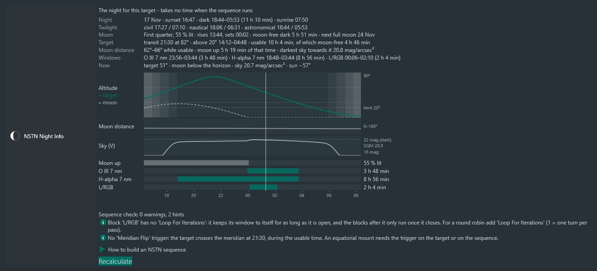

# NSTN für N.I.N.A.

Plugin für den Advanced Sequencer von N.I.N.A. 3.2.

- **„NSTN filter plan“ (ab 0.7.0):** Ein einzelner Befehl mit einer Tabelle, eine Zeile je Filter.
  Er belichtet jeden Filter, solange das NSTN-Himmelsmodell sein Band für das Ziel als lohnend
  bewertet, Runde für Runde bis zum Ende der Nacht.
- **„Loop while NSTN window open“:** Die Bedingung dahinter, für den Aufbau von Hand. Sie lässt
  einen Befehlsblock nur laufen, solange sein Band (L/RGB, Hα, O III, S II, Hβ) lohnt.
- Beide zeigen im Sequencer das Fenster der Nacht und den aktuellen Zustand.

**Anleitung für Anwender:** [docs/Anleitung.md](docs/Anleitung.md).

Das Nachtmodell ist ein wörtlicher Port von FITSORAs `fitsora/domain/night.py`
(selbst ein Port des TypeScript-Belichtungsplaners) und wird gegen dieselben
Goldfixtures geprüft (`tests/Nstn.Core.Tests/golden/`).

## Aufbau

| Pfad | Inhalt |
|---|---|
| `src/Nstn.Core` | Nachtmodell, `WindowForecaster`, `PlanSimulator`, `FilterCatalog`, `FilterAssignments`, `NightInfo`, `SequenceCheck`, `Text` + `Strings/*.json` (Übersetzungen) (net8.0, keine NINA-/WPF-Abhängigkeit) |
| `tests/Nstn.Core.Tests` | Goldtests gegen `night_model.json`, Forecaster-, Simulator-, Katalog-, Night-Info-, Sequenzprüfungs- und Übersetzungstests (xUnit, net10.0) |
| `src/NINA.Plugin.Nstn` | NINA-Plugin (net8.0-windows, WPF, `NINA.Plugin` 3.2.0.9001) |
| `build.ps1` | Tests + Build im Docker-SDK-Container, legt `dist\NINA.Plugin.Nstn-<Version>.zip` und `dist\NSTN-Installer-<Version>.zip` an |
| `installer/` | Installer zum Weitergeben (`Install-NSTN.ps1` für Windows PowerShell 5.1, `.cmd`-Starter, `LIESMICH.txt`) und `Pack-Installer.ps1` |
| `tests/NINA.Plugin.Nstn.Checks`, `tests/Run-NinaChecks.ps1` | Prüfprogramm gegen die DLLs des installierten N.I.N.A. (Windows) |
| `tests/NinaTestInstance` | Abnahme in N.I.N.A.: abgeschottete Testinstanz (Startup Hook), Alpaca-Simulatoren im Container, Testordner mit Profilkopie |
| `docs/Anleitung.md` | Anleitung für Anwender (Deutsch) |

## Bauen

Voraussetzung: Docker mit `mcr.microsoft.com/dotnet/sdk:10.0`. Kein lokales .NET-SDK nötig.

```powershell
.\build.ps1
```

Ergebnis: `dist\NSTN\` mit genau drei DLLs (`NINA.Plugin.Nstn.dll`, `Nstn.Core.dll`,
`astronomy.dll`) und `THIRD-PARTY-NOTICES.txt` (MIT-Lizenz der Astronomy Engine, Quelle
`src\NINA.Plugin.Nstn\`), das ZIP darum und der Installer `dist\NSTN-Installer-<Version>.zip`.
Danach `tests\Run-NinaChecks.ps1`: es prüft genau diese drei DLLs.

Nur `build.ps1` schreibt `dist\NSTN` (`-p:NstnStage=true`). Bis 0.11.1 tat das jeder Build des
Plugin-Projekts, auch der des Prüfprogramms, und zwei Builds derselben Quelle ergeben andere
Bytes (Zeitstempel, MVID, PDB-ID). Das ZIP aus `build.ps1` trug dann andere DLLs als die geprüften.

### Installer

`dist\NSTN-Installer-<Version>.zip` ist für andere Rechner gedacht: entpacken, N.I.N.A. schließen,
`Install-NSTN.cmd` doppelklicken. Er läuft mit dem Windows PowerShell 5.1 jedes Windows 10/11,
ohne Administratorrechte, und installiert für den angemeldeten Benutzer nach
`%LOCALAPPDATA%\NINA\Plugins\3.0.0\NSTN`.

- **Vorher:** bricht ab, wenn N.I.N.A. läuft oder eine Datei nicht zu `SHA256SUMS.txt` passt;
  nennt die installierte N.I.N.A.-Version und warnt unter 3.2.0.9001.
- **Sicherung:** eine vorhandene Version geht nach `%LOCALAPPDATA%\NINA\NSTN-Sicherung\<Zeitpunkt>-<Version>`,
  außerhalb von `Plugins\`, damit N.I.N.A. sie nicht als zweites Plugin lädt.
- **Danach:** Zielordner enthält genau die Paketdateien, Prüfsummen erneut geprüft, Sperrvermerk aus dem Internet entfernt.
- **Optionen:** `-Uninstall` (auch `Uninstall-NSTN.cmd`, ebenfalls mit Sicherung), `-PluginDir` für einen anderen Ordner, `-NoPause`.
- **Kodierung:** `Install-NSTN.ps1` braucht eine BOM, sonst liest Windows PowerShell 5.1 es als ANSI und
  zerstört die Umlaute; die `.cmd`-Dateien sind reines ASCII. `Pack-Installer.ps1` schreibt beides so.
- **Aus PowerShell 7 gestartet** erbt `powershell.exe` dessen Modulpfad und findet `Get-FileHash` nicht.
  Die `.cmd` setzt den Modulpfad zurück, das Skript rechnet die Prüfsummen ohnehin mit .NET.

### Prüfungen gegen N.I.N.A.

`build.ps1` testet den Rechenkern im Linux-Container. Was N.I.N.A.s eigene Klassen braucht,
prüft `tests\Run-NinaChecks.ps1` unter Windows gegen die DLLs des installierten
N.I.N.A. 3.2.0.9001. Dazu gehören Laden und Speichern, Drag & Drop, Vorlagen,
`Sequencer.Validate` und Läufe mit `SequentialStrategy`, den echten Triggern und Stub-Geräten.
Geprüft werden die Plugin-Dateien aus `dist\NSTN`, also erst `.\build.ps1`; ist eine der beiden
eigenen DLLs älter als ihre Quellen, bricht das Skript ab:

```powershell
.\tests\Run-NinaChecks.ps1            # alle Prüfungen, etwa 2 Minuten
.\tests\Run-NinaChecks.ps1 -NoRuns    # ohne die Läufe, etwa 20 Sekunden
```

- **Was die Läufe prüfen:** Trigger am Ziel greifen zwischen den Belichtungen. „Runden je Filter“
  spart AF-Läufe. Der Filterplan endet nach gescheiterten Belichtungen und am Ende der Nacht von selbst.
- **Feste Nacht:** Die NSTN-Uhr läuft dabei in der Nacht 18./19.11.2026. Das geht über `NstnClock`,
  das nur dieses Prüfprogramm verstellen kann.
- **Kein Zugriff aufs echte Profil:** Logger, Datenbank und Ausgaben liegen in einem Wegwerfordner.
  Exit-Code 0 heißt alles grün.
- **Golddatei:** `tests\NINA.Plugin.Nstn.Checks\golden\filterplan-3.2.json` muss unverändert laden und
  gleich wieder geschrieben werden. Nach einer gewollten Formatänderung neu schreiben mit
  `-WriteGolden` und den Diff ansehen.

### Abnahme in N.I.N.A. mit Simulatoren

Für einen Lauf in der echten Oberfläche, ohne das installierte N.I.N.A. oder sein Profil anzufassen:

```powershell
.\build.ps1
.\tests\NinaTestInstance\Start-Simulators.ps1 -SimulatorDir <ausgepackt>\ascom.alpaca.simulators.linux-x64
.\tests\NinaTestInstance\New-NinaTestRoot.ps1 -TestRoot C:\Temp\nina-test\3.2 -SourceProfile <Profil>.profile
.\tests\NINA.Plugin.Nstn.Checks\bin\checks\NINA.Plugin.Nstn.Checks.exe C:\Temp\nina-test\out write-flip-sequence C:\Temp\nina-test\flip.json
.\tests\NinaTestInstance\Start-NinaTest.ps1 -NinaExe "<N.I.N.A.-Ordner>\NINA.exe" -TestRoot C:\Temp\nina-test\3.2 `
    -SequenceFile C:\Temp\nina-test\flip.json -Run -NstnClockUtc 2026-11-19T04:40:00Z
.\tests\NinaTestInstance\Start-Simulators.ps1 -Stop
```

- **Simulatoren:** ASCOM Alpaca Omni-Simulator (Linux-Build von GitHub) im Docker-Container.
  Gebraucht werden Montierung, Filterrad und Fokussierer; Guider ist „Mount Dither“, die Kamera die
  Simulatorkamera des Profils. N.I.N.A. findet sie über die eigene Alpaca-Suche, eine ASCOM-Plattform
  ist nicht nötig.
- **Abschottung:** `NinaTestHook` lenkt Profile, Plugins, Logs, Datenbank und Caches in den
  Testordner und hält die Anwendungseinstellungen im Speicher. Die Testinstanz läuft auch neben
  einem geöffneten N.I.N.A.
- **Testsequenz:** Sie stellt das Ziel 10 Minuten vor den Meridian. So muss im Lauf ein
  Meridian-Flip kommen.
- **NSTN-Uhr:** `-NstnClockUtc` lässt die NSTN-Uhr ab einer Nachtzeit laufen, damit tagsüber Fenster
  offen sind (per Reflection auf `NstnClock`; das Plugin selbst hat dafür keinen Schalter).
- **Auch für N.I.N.A. 3.3:** Für die 3.3-Nightly das Setup nicht installieren, es ersetzt 3.2.
  Stattdessen auspacken und `-NinaExe` darauf zeigen lassen.

## Installieren (manuell)

1. N.I.N.A. beenden.
2. Den Ordner `NSTN` aus dem ZIP nach `%LOCALAPPDATA%\NINA\Plugins\3.0.0\` entpacken
   (ergibt `...\Plugins\3.0.0\NSTN\*.dll`).
3. N.I.N.A. starten, unter *Options → Plugins → NSTN* den **SQM-Wert** des Standorts
   eintragen. Breite/Länge kommen aus dem Profil (*Options → General → Astrometry*).

## Benutzen

**Der einfache Weg ist der Filterplan** (ab 0.7.0, siehe unten und [docs/Anleitung.md](docs/Anleitung.md)).
Dieser Abschnitt beschreibt das Muster von Hand.

Die Bedingung gehört an einen Befehlsblock **innerhalb eines Ziel-Containers** (sie
braucht dessen Koordinaten). Geprüft wird vor jedem Befehl, auch in verschachtelten
Blöcken; eine laufende Belichtung wird zu Ende geführt, nie abgebrochen.

Muster für mehrere Filter (Rundlauf, Gewichtung über die Anzahl je Block):

```
Ziel NGC 7000
  Anfahren & Zentrieren
  Schleife – Loop Until Time: Morgendämmerung
    Wait for NSTN window
    Block OIII – Bedingungen: NSTN O III 7 nm + Loop For Iterations 1 → Smart Exposure 5 × 300 s OIII
    Block Hα   – Bedingungen: NSTN H-alpha 7 nm + Loop For Iterations 1 → Smart Exposure 5 × 300 s Ha
    Block SII  – Bedingungen: NSTN S II 7 nm + Loop For Iterations 1 → Smart Exposure 5 × 300 s SII
  Trigger: Autofokus, Meridian-Flip, Dithern
```

**Bedingungen an einem Block sind Schleifenbedingungen.** Hat ein Block nur die
NSTN-Bedingung, wiederholt N.I.N.A. ihn, solange sein Fenster offen ist: Er behält das
Fenster für sich (strikter Vorrang). Erst „Loop For Iterations 1" am Block macht daraus
einen Rundlauf, bei dem jeder Block pro Schleifendurchlauf einmal drankommt.

Ein Block, dessen Fenster zu ist, wird übersprungen. **„Wait for NSTN window" gehört an
den Anfang der Schleife:** Sind alle Fenster zu, würde N.I.N.A. 3.2 die Schleife sonst
ungebremst leer durchlaufen (eine Bremse von 250 ms je Durchlauf gibt es erst ab 3.3).
Der Befehl liest die Bänder aus den NSTN-Bedingungen der Blöcke darunter und wartet, bis
eines öffnet. Öffnet in dieser Nacht keines mehr, wartet er weiter, bis die
Schleifenbedingung (z. B. Morgendämmerung) die Schleife beendet.


## NSTN-Filterplan (ab 0.7.0)

Ein Befehl wie Smart Exposure: Die Tabelle ist die einzige Quelle, daraus baut der Plan das
NSTN-Muster:

```
NSTN filter plan          [Bedingung: Loop while an NSTN window opens tonight]
  Wait for NSTN window
  je Zeile: Block [Loop while NSTN window open „@block“, Loop For Iterations = Runden je Filter]
              Switch Filter (Filter der Zeile)
              Reihe [Loop For Iterations = Anzahl]  Take Exposure (Zeit der Zeile; Gain/Offset/Binning des Plans)
```

- **Werte:**
  - je Zeile Filter (Name wie im Profil), Anzahl je Runde und Belichtungszeit;
  - für den Plan Gain, Offset, Binning und „Runden je Filter“ (1 = Rundlauf, mehr spart
    Filterwechsel und AF-Läufe);
  - „Abbruch nach Fehlschlägen in Folge“ (Standard 3, 0 = nie).
  - Das Band jeder Zeile kommt aus „Filter dieses Profils“.
- **Ende ohne Uhrzeit:** Der Plan läuft, bis heute Nacht kein Fenster mehr öffnet, oder bis die
  eingestellte Zahl Aufnahmen hintereinander gescheitert ist. Dann gibt es eine Meldung und eine
  Warnung im Protokoll.
  - Ohne diese Grenze würde ein Plan ohne Kamera oder Bildordner die Nacht mit Filterwechseln
    und AF-Läufen verbringen.
  - N.I.N.A. 3.2 setzt bei einer gescheiterten Prüfung FAILED zweimal. Gezählt wird nur der
    Übergang nach FAILED.
- **Anzeige:**
  - die Tabelle, die Planwerte und die Gliederung;
  - je Zeile das Fenster heute Nacht und der Zustand jetzt;
  - der Nachtplan des versteckten Warte-Befehls;
  - im Aufnahme-Reiter eine Kurzansicht.
- **Laden und Speichern:**
  - Laden geht über die Fabrikvorlage, `Clone()` und Populate.
  - Passende Kinder aus der Datei bleiben erhalten, widersprechende werden aus der Tabelle neu gebaut.
  - `Validate()` sammelt die Probleme der Kinder selbst, weil N.I.N.A. Immutable-Container überspringt.
  - Während des Laufs ist der Plan gesperrt.
- **Sequenzprüfung der Night Info:**
  - Hinweis bei Rundlauf mit „AF nach Filterwechsel“.
  - Warnung, wenn hinter einem Plan im selben Container noch NSTN-Arbeit steht; die bekommt in
    dieser Nacht keine Zeit mehr.
- **Grenze:** je Zeile eine Linie. Duo-Filter an der Farbkamera mit zwei Linien geht nur von Hand.

## Filter-Voreinstellungen (ab 0.3.0)

Im Feld **Filter** der Bedingung stehen die Duo-Filter und Schmalband-Sätze aus den
NSTN-Tabellen (`src/Nstn.Core/Filters/*.csv`, unverändert aus `astro-public`). Mit einem
Filter zeigt **Band** nur dessen Linien, die Bandbreite kommt aus der Tabelle und ist
gesperrt; „Custom" erlaubt beides von Hand.

- Ein **Duo-Filter** startet auf seiner schwächeren Linie – der mit dem meisten
  Streulicht im Band (Bandbreite × Rayleigh-Gewicht), meist O III. Wählt man die
  robustere Linie, sagt ein Hinweis, dass der andere Kanal dann schon überstrahlt ist.
  Bei Farbkameras ist das eine legitime Wahl: zwei Blöcke, „solange O III offen" und
  „solange Hα offen", sammeln Hα länger (`samples/M31-NSTN-Duo.json`).
- Gespeichert werden Linie, Bandbreite **und** Filtername; Linie und Bandbreite bleiben
  maßgeblich. Beim Laden wird die gespeicherte Linie nie durch die Voreinstellung ersetzt,
  unabhängig von der Reihenfolge der Felder in der Datei.
- Die Tabellen sind ein Vorschlag: Askar verkauft einen D1 mit 6/6 nm und einen
  „Super D1" mit 8,5/6,5 nm. Nahe der Schwelle verschiebt 1 nm das Fenster deutlich
  (M 31 am 17.11.: O III 6 nm ab 22:18, 7 nm ab 23:56).

## Filter des Profils (ab 0.4.0)

Unter *Options → Plugins → NSTN → Filters of this profile* steht jeder Filter der
Filterradliste des Profils mit dem, was er durchlässt: „not assigned", „Broadband",
„Custom" (Linie + Bandbreite von Hand) oder ein Filter aus den NSTN-Tabellen. Gespeichert
wird je Profil.

- **Vorschläge** erscheinen neben jeder Zeile und werden nur per Knopf übernommen.
  Erkannt werden bekannte Produkte (Askar D1/D2/C1/C2, Optolong L-eNhance/L-eXtreme/
  L-Ultimate/L-Para/L-Synergy, SV220 mit Bandbreite), Breitbandnamen (L, R, G, B, Lum,
  kein_Filter, NoFilter, UV/IR) und einzelne Linien **mit** Bandbreite im Namen
  („Ha 3nm"). Keine Bandbreite wird erfunden: „Ha" allein, „Super D1" oder „ALP-T" bleiben
  ohne Vorschlag.
- In der Bedingung macht **Filter → „From this block's filter"** daraus die Quelle: Die
  Bedingung liest den Filter aus dem Switch Filter bzw. der Smart Exposure ihres Blocks
  und nimmt Band und Bandbreite aus der Zuordnung. Ändert man den Filter in der Smart
  Exposure, folgt die NSTN-Bedingung. Fehlt der Filter, nutzt der Block mehrere Filter
  oder ist der Filter nicht zugeordnet, meldet die Bedingung das als Problem.
- Für die Farbkamera mit Duo-Filter und zwei Blöcken (O III und Hα mit demselben Filter)
  passt diese Quelle nicht – dort den Filter direkt in der Bedingung wählen.

`samples/M31-NSTN-Block.json` braucht die Filter „Askar D1", „Ha" und „L" im Profil.


## Nachtplan (ab 0.2.0)

„Wait for NSTN window" zeigt unter sich, was die gebaute Struktur heute Nacht ab jetzt
voraussichtlich bringt: je Block das Fenster (blass), die Zeiten, in denen er belichten
würde (kräftig), Integrationszeit und Anzahl, dazu eine Zusammenfassung je Band und wann
und warum der Plan endet. Hinweise erscheinen darunter, etwa wenn ein Block ohne
Iterationsgrenze das Fenster für sich behält oder die äußere Schleife keine Bedingung hat
und deshalb nur einmal läuft.


Gerechnet wird nach den Regeln des Sequencers (Prüfung vor jeder Aufnahme, begonnene
Aufnahmen laufen zu Ende, Blockgrenze aus „Loop For Iterations", Ende aus „Loop For
Iterations" bzw. „Loop Until Time" der äußeren Schleife). Verschachtelte Reihen wie Smart
Exposure werden aufgelöst. Je Aufnahme kommt ein Zuschlag dazu (*Options → Plugins → NSTN*,
Standard 10 s); Autofokus, Meridian-Flip, Filterwechsel und Schwenks sind nicht enthalten.
Der Plan aktualisiert sich alle 20 s und per „Recalculate".

## Night Info (ab 0.5.0)

**„NSTN Night Info"** gehört an den Anfang eines Ziel-Containers. Der Befehl kostet beim
Ablauf keine Zeit (er schreibt nur eine Zusammenfassung ins Protokoll) und zeigt im
Sequencer:

- **Eckdaten der Nacht:** Sonnenuntergang/-aufgang, bürgerliche, nautische und
  astronomische Dämmerung, Dunkelzeit; Mondphase, Beleuchtung, Auf-/Untergang, mondfreie
  Dunkelzeit, nächster Voll- bzw. Neumond; Ziel: Kulmination, Zeit über der Mindesthöhe,
  nutzbare Zeit (davon mondfrei), Mondabstand über die nutzbare Zeit, dunkelster Himmel
  Richtung Ziel; die Fenster je Band; der Zustand jetzt.
- **Diagramm** von Sonnenuntergang − 30 min bis Sonnenaufgang + 30 min: Höhe von Ziel
  (durchgezogen) und Mond (gestrichelt) über der Dämmerung (heller = hellerer Himmel),
  Mindesthöhe, Kulmination; Mondabstand (0–180°); Himmelshelligkeit Richtung Ziel (V,
  16–22 mag) mit SQM-Linie; Zeile „Moon up" (Deckkraft nach Beleuchtung) und je Band die
  Fenster; Jetzt-Linie. Unter der Maus je 10 min: Uhrzeit, Zielhöhe und Luftmasse,
  Mondhöhe und -abstand, Himmel, Sonnenhöhe, offene Fenster.
- Die Bänder kommen aus den NSTN-Bedingungen unter dem Ziel; ohne Bedingung zeigt er
  L/RGB, Hα, O III, S II (je 7 nm).
- **Sequenzprüfung** des Ziel-Containers nach den Regeln, die N.I.N.A. tatsächlich anwendet –
  Warnungen (rot) und Hinweise:

  | Regel | Stufe |
  |---|---|
  | Schleife um die Blöcke ohne eigene Bedingung (läuft genau einmal) | Warnung |
  | Schleife ohne „Wait for NSTN window" (dreht in 3.2 ungebremst) | Warnung |
  | Warte-Befehl nicht an erster Stelle / innerhalb eines Blocks | Hinweis / Warnung |
  | Mehrere Blöcke, einer ohne „Loop For Iterations" (Vorrang statt Rundlauf) | Hinweis |
  | Block ohne Aufnahme | Warnung |
  | Filter im Block passt nicht zum Band der Bedingung (über die Profil-Zuordnung) | Warnung |
  | Eigene Probleme der Bedingung (kein SQM, Blockfilter fehlt/unbekannt …) | Warnung |
  | Fenster öffnet an diesem Standort nie / heute Nacht nicht | Warnung / Hinweis |
  | Aufnahmen in der Schleife außerhalb eines NSTN-Blocks | Hinweis |
  | NSTN-Bedingung direkt am Ziel-Container | Warnung |
  | Ziel kommt nicht über die Mindesthöhe bzw. nur außerhalb der Nacht | Warnung |
  | Kein Meridian-Flip-Trigger (Ziel, Zwischen-Container oder darüber), obwohl das Ziel in der nutzbaren Zeit kulminiert | Hinweis |

- **„How to build an NSTN sequence"** (aufklappbar, ebenso in der Plugin-Beschreibung):
  Baum des empfohlenen Aufbaus und sieben Regeln – Bedingungen sind Schleifenbedingungen,
  ein Block je Filter, „Loop For Iterations" für den Rundlauf, eigenes Ende der Schleife,
  Warte-Befehl zuerst, Trigger am Ziel, laufende Aufnahmen werden nie abgebrochen.

Aktualisiert wird alle 20 s (nur in der aktiven Sequenz) und per „Recalculate". Die Nacht
teilt sich den Zwischenspeicher mit den Bedingungen (`WindowForecaster.Night`), Fenster und
Anzeige können also nicht auseinanderlaufen.



## Sprache (ab 0.6.0)

Das Plugin spricht die Sprache von N.I.N.A. (*Optionen → Allgemein → Sprache*, je Profil):
**Englisch und Deutsch**, andere Sprachen fallen auf Englisch zurück. Ein Wechsel wirkt
sofort, ohne Neustart.

- Texte stehen je Sprache in `src/Nstn.Core/Strings/<sprache>.json` (eingebettet, keine
  Satelliten-DLLs – das Plugin bleibt drei DLLs). Eine neue Sprache = eine neue Datei mit
  denselben Schlüsseln.
- **N.I.N.A.s eigene Befehlsnamen** („Loop For Iterations“ / „Schleife für Iterationen“,
  „Meridian Flip“ / „Meridianflip“, Menüpfade) stehen als Platzhalter `{nina:…}` in den
  Texten und kommen zur Laufzeit aus N.I.N.A. – sie passen damit in jeder Sprache zu dem,
  was der Benutzer im Sequencer sieht. Deutsche Texte setzen deshalb keinen Artikel vor
  diese Namen.
- Zahlen und Datum im Format der Sprache (20,7 mag/arcsec², „17. Nov.“).
- Namen und Beschreibungen in der Befehlsliste: N.I.N.A.s Lader setzt sie einmal aus den
  englischen Export-Metadaten; das Plugin benennt sie in `Initialize()` und bei jedem
  Sprachwechsel um.
- Tests: gleiche Schlüssel und Platzhalter in allen Sprachen, jeder im Code benutzte
  Schlüssel vorhanden und jeder Eintrag benutzt (der Quelltext wird gelesen), die englische
  Anleitung in der Plugin-Beschreibung (`SequenceGuide.cs`, aus `en.json` erzeugt) gleich
  der im Sequencer.
- Englisch bleiben: Protokollzeilen (für die Fehlersuche) und die Plugin-Beschreibung im
  Plugin-Manager (Manifest).

## Beispiele

`samples/NSTN-LRGB-Ha.json` (englisch) und `samples/NSTN-LRGB-Ha.de.json` (deutsch):
**Beispielsequenz zum Teilen**, eine komplette Sequenz mit dem NSTN-Filterplan. Laden über
*Advanced Sequencer → Load sequence*. Eine komplette Sequenz kann keine Vorlage sein, denn
N.I.N.A. überspringt Wurzel-Container im Vorlagenordner (`TemplateController`). Inhalt:

- **Start:** Kamera auf −10 °C kühlen, entparken.
- **Ziel:** M 33.
  - Auslöser: Meridianflip, Dither nach 3 Aufnahmen, **AF nach Zeit (60 min)**.
  - Darin: Hinweis, NSTN Night Info, warten bis zur nautischen Dämmerung und bis 20° Höhe, schwenken und zentrieren, Hinweis zum Autofokus, **Autofokus**, Guiding starten.
  - Filterplan: L/RGB 3:1:1:1 (L 60 s, RGB 120 s) mit Vorrang und Ha 5 × 300 s, Sätze am Stück 2.
- **Ende:** Guiding stoppen, aufwärmen, parken.

**Autofokus auf L (19.11.2026, auf Marcs Wunsch):** einmal vor dem Guiding, dann jede
Stunde. Den Filterwechsel auf L macht N.I.N.A. selbst, wenn im Profil zwei Dinge gesetzt sind:
der L-Filter als „Autofokus Filter“ und „Filterrad Offsets nutzen“ (Okularauszug). Geprüft an
N.I.N.A. 3.2.0.9001 selbst: `AutoFocusVM.StartAutoFocus` ruft `SetAutofocusFilter` auf; das
wechselt nur bei `UseFilterWheelOffsets` auf den AF-Filter. Am Ende wechselt `StartAutoFocus`
per `ChangeFilter` zurück. Der Filterplan läuft also mit seinem Filter weiter. Ein
„Filter wechseln“ im Auslöser ginge schief: Der Filterplan wechselt den Filter am Anfang
eines Blocks, die restlichen Aufnahmen dieses Blocks lägen dann auf L.

Erzeugt werden beide Dateien mit N.I.N.A.s eigenem Serializer über `tests\Run-NinaChecks.ps1
-WriteSequence`, mit SQM und Filterzuordnungen wie bei einem Nutzer. Dabei wird geprüft, dass
N.I.N.A. sie ohne unbekannte Typen lädt und unverändert wieder speichert, und dass die
Sequenzprüfung der Nachtinfo keine Warnung meldet.

`samples/M31-NSTN-Test.json`: kurzer Testlauf für M 31 (3 Durchläufe, je Block höchstens
2 × 2 s). `samples/M31-NSTN-Plan.json`: eine Nacht im Rundlauf (O III und Hα je 5 × 300 s
pro Durchlauf, L/RGB absichtlich ohne Grenze) für den Nachtplan.
`samples/M31-NSTN-Duo.json`: Askar D1 an einer Farbkamera, je ein Block für O III und Hα. Alle Beispiele
beginnen mit „NSTN Night Info". In N.I.N.A. über
*Advanced Sequencer → Load sequence* laden; N.I.N.A. packt einen einzelnen Ziel-Container
selbst in eine neue Sequenz. Erzeugt werden die Dateien mit
`python samples/make_sample.py [full|plan|duo|block]` (`mistakes` erzeugt eine absichtlich
fehlerhafte Sequenz für die Sequenzprüfung) – wichtig für eigene Generatoren: jedes Element
braucht `"Parent": {"$ref": …}` auf seinen Container, sonst hat es nach dem Laden keinen
Elternteil und findet sein Ziel nicht.

## Getestet (17.11.2026, N.I.N.A. 3.2.0.9001, Simulator-Kamera)

| Prüfung | Ergebnis |
|---|---|
| Laden im Plugin-Manager, Optionsseite, Speichern im Profil | ok |
| Fensteranzeige gegen den Python-Port (M 31, 49,8° N, SQM 20,9) | identisch: Hα 18:48–03:44, O III 23:56–03:44, L/RGB ab 00:06 |
| Lauf mit Hα offen, O III und L/RGB zu | O III/L/RGB übersprungen, 6 Hα-Aufnahmen gespeichert |
| Alle Fenster zu, **ohne** Warte-Befehl | 1000 Leerdurchläufe in 0,56 s (N.I.N.A. 3.2 bremst nicht) |
| Alle Fenster zu, **mit** Warte-Befehl | wartet („O III opens 23:56"), 8 % eines Kerns (Leerlauf 2 %), Abbrechen ok |
| Anzeige-Refresh markiert die Sequenz nicht als geändert | ok |
| Nachtplan 0.2.0 (M31-NSTN-Plan.json ab 23:41) | O III 10 × 300 s, Hα 14 × 300 s, L/RGB 57 × 120 s, Ende 03:48; Vorrang-Hinweis bei L/RGB |
| Nachtplan nach Änderung der äußeren Schleife (1000 → 2) | per „Recalculate" und automatisch nach ≤ 20 s: Ende 03:02, „loop iterations used up" |
| Voreinstellungen 0.3.0 laden (M31-NSTN-Duo.json, beide Feldreihenfolgen) | Askar D1, O III bzw. Hα wie gespeichert, 6 nm gesperrt; Hinweis beim Hα-Block; Fenster = Python-Port (O III 6 nm 22:18–04:30, Hα 6 nm 18:36–04:30) |
| Filterwechsel in der Oberfläche (→ L-eXtreme 7 nm) | Band springt auf O III, 7 nm, Hinweis weg, Fenster 23:56–03:44 |
| Filter des Profils 0.4.0 (Askar D1, Ha, L angelegt) | Zeilen erscheinen, Vorschläge D1 → O III 6 nm und L → Breitband, „Ha" ohne Vorschlag; per Knopf übernommen, Ha von Hand Custom 7 nm; im Profil gespeichert |
| M31-NSTN-Block.json per `--sequencefile` | lädt, N.I.N.A. bleibt bedienbar; Block „Askar D1": „Block filter: Askar D1 → OIII 6 nm", Fenster 22:18–04:30; Nachtplan rechnet mit O III 6 nm / Hα 7 nm / L/RGB |
| Filter im Switch Filter umstellen (Askar D1 → Ha → L) | Band folgt in ≤ 30 s: H-alpha 656 nm, 7 nm, 18:48–03:44; dann L/RGB, 00:06–02:10 |

**Night Info 0.5.0 (18.11.2026, `--sequencefile`, M 31 bei 49,8° N, SQM 20,9):**

| Prüfung | Ergebnis |
|---|---|
| M31-NSTN-Plan.json | Eckdaten plausibel (Untergang 16:47, Dunkel 18:44–05:53, Mond 55 %, untergeht 00:02, Kulmination 21:30 bei 82°), Fenster = Bedingungen (Hα 18:48–03:44, O III 23:56–03:44, L/RGB 00:06–02:10); Prüfung: 2 Hinweise (L/RGB ohne Iterationsgrenze, kein Meridian-Flip-Trigger) |
| M31-NSTN-mistakes.json | 2 Warnungen (Block ohne Aufnahme, Schleife ohne Warte-Befehl), 4 Hinweise (2 × Vorrang, lose Aufnahme, Meridian-Flip) |
| Tooltip, Leitfaden aufklappen, Laden ohne Verklemmung | ok |
| Ausführen des Befehls im Sequenzlauf | **nicht geprüft** (nur Protokollzeile, kein Kamera-Lauf) |

**Übersetzung 0.6.0 (18.11.2026, Profil `de-DE` und `en-GB`):**

| Prüfung | Ergebnis |
|---|---|
| Start mit deutschem Profil (M31-NSTN-Plan.json) | Nachtinfo, Warte-Befehl, Nachtplan, Bedingung, Auswahllisten, Optionsseite auf Deutsch; „Schleife für Iterationen“, „Meridianflip“, „Optionen > Allgemein > Astrometrie“ aus N.I.N.A.; „17. Nov.“, „20,8 mag/arcsec²“ |
| Live-Wechsel Deutsch → Englisch → Deutsch | alle Plugin-Texte folgen ohne Neustart. Befund: Name der Bedingung und gewählter Eintrag der Filterauswahl blieben zunächst in der alten Sprache (N.I.N.A.s `SequenceCondition.Name` meldet keine Änderung, Auswahl-Einträge ohne Änderungsmeldung) – behoben |
| N.I.N.A.s eigene, schon geladene Befehle | behalten beim Live-Wechsel ihren alten Namen – Verhalten von N.I.N.A., nicht des Plugins |

**Zwei Fehler aus dem Test vom 17.11., in 0.4.0 behoben:**

- *Verklemmung beim Laden einer Sequenz im Block-Modus.* N.I.N.A. 3.2 schützt alle
  Container mit **einer statischen Sperre** und ruft `Validate()` der Elemente unter dieser
  Sperre auf; der Warte-Befehl fragt dabei die Bedingung. Die Bedingung las im
  Hintergrund-Refresh die Elemente ihres Blocks (`GetItemsSnapshot`, nimmt die
  Container-Sperre) **innerhalb** ihrer eigenen Sperre – überkreuzte Sperrreihenfolge.
  Folge: N.I.N.A. nahm keine Eingaben mehr an, meldete sich aber als „Responding" (ein
  wartender STA-Thread pumpt nur noch einen Teil der Nachrichten). Jetzt wird alles aus den
  Containern **vor** der eigenen Sperre gelesen.
- *Leere Bandauswahl nach Filterwechsel.* Die Bandliste war bei jedem Abruf eine neue
  Liste; eine WPF-ComboBox setzt dann ihre Auswahl zurück. Jetzt gibt es je Katalogfilter
  genau eine Liste, im Block-Modus immer die vollständige.

0.1.1 behebt einen Befund aus diesem Test: 0.1.0 schrieb bei Leerdurchläufen je
Bedingung und Prüfung eine Protokollzeile (2000 Zeilen je 1000 Durchläufe); jetzt nur bei
einem echten Zustandswechsel. N.I.N.A. selbst schreibt weiter 4 Zeilen je übersprungenem
Block – ein Grund mehr für den Warte-Befehl.

## Getestet (18.11.2026, 0.7.0, NINA-Testinstanzen mit Alpaca-Simulatoren)

| Prüfung | Ergebnis |
|---|---|
| `build.ps1` | 213/213 Kerntests |
| `tests\Run-NinaChecks.ps1` gegen 3.2.0.9001 | 115/115, darunter Golddatei 3.2 und vier Läufe mit SequentialStrategy |
| Abnahme 3.2.0.9001 (Testinstanz, NSTN-Uhr 05:40, Plan Rundlauf mit Night Info, Ziel 6 min vor dem Meridian) | Meridian-Flip echt ausgeführt (pierWest → pierEast), danach weiter belichtet; 30 Aufnahmen, 13 × AF nach Filterwechsel, 29 × Dither erfolgreich; Night Info im Lauf ausgeführt (Protokollzeile) |
| Abnahme 3.3.0.1069 (ausgepackt, dasselbe net8-Build 0.7.0, gleicher Lauf) | Meridian-Flip echt ausgeführt; 30 Aufnahmen, 13 × AF, 29 × Dither erfolgreich; Night Info ausgeführt |

## 0.7.1 (18.11.2026)

Neu sind die Beispielsequenz `samples/NSTN-LRGB-Ha.json` (siehe [Beispiele](#beispiele)) und ein
eigener Text für Breitband, wenn ein Fenster an diesem Standort nie öffnet. Bisher nannte die
Meldung auch für L/RGB „7 nm“ und riet zur Schmalband-Schwelle.

| Prüfung | Ergebnis |
|---|---|
| `build.ps1` | 213/213 Kerntests |
| `tests\Run-NinaChecks.ps1` gegen 3.2.0.9001 | 119/119; neu die Meldung „öffnet nie“ für Breitband und Schmalband an einer echten Bedingung im Ziel-Container. Die Gegenprobe mit dem alten Text fällt. |
| `tests\Run-NinaChecks.ps1 -WriteSequence` | Beispielsequenz: Laden und erneutes Speichern ergeben dieselbe Datei, keine unbekannten Typen |
| Testinstanz 3.2.0.9001 mit 0.7.1 und einer Profilkopie (Filter L, R, G, B, S2, Ha, O3) | Beispielsequenz geladen, keine Fehler oder Warnungen im Protokoll, Filterplan passt zu seinen Zeilen. Angesehen wurde die Ansicht mit dem 0.7.0-Build: alle Teile von Start bis Ende vorhanden |

## 0.7.2 (18.11.2026)

- **Nachtplan und Nachtinfo ziehen nach.** Beim Einfügen eines Filterplans und nach jeder Zeilenänderung zeigen beide sofort alle Zeilen, nicht erst nach ihrer 20-s-Aktualisierung.
  - Erste Ursache: Eine neue Fensterbedingung rechnet zum ersten Mal, bevor ihr Block im Ziel hängt. Dieses Ergebnis ohne Vorhersage wurde 2 s lang wiederverwendet. Jetzt wird nur noch eine echte Vorhersage wiederverwendet.
  - Zweite Ursache: Der Warte-Befehl plante, bevor die Blöcke hinter ihm standen. Jetzt stößt der Plan nach dem Neuaufbau seinen Nachtplan und die Nachtinfo im Ziel an.
- **Filtersätze nehmen die Linie aus dem Namen.** Bei „Astronomik (6 nm)“ wird „S2“ zu S II und „O3“ zu O III; bisher blieb es bei Hα. Eine gespeicherte Zuordnung, die dem Namen widerspricht, zeigt „prüfen: der Filtername nennt …“.

| Prüfung | Ergebnis |
|---|---|
| `build.ps1` | 222/222 Kerntests, neu: Linie aus dem Filternamen |
| `tests\Run-NinaChecks.ps1` gegen 3.2.0.9001 | 130/130 mit Läufen. Neu: Nachtplan und Nachtinfo nach dem Hinzufügen von Zeilen, Linie aus dem Namen und Hinweis bei Widerspruch. Gegenproben: ohne jede der beiden Korrekturen fallen die zugehörigen Prüfungen |

## 0.8.0 (18.11.2026)

**Eigenes Fenster je Filterzeile.** Unter „Eigenes Fenster“ hat jede Zeile vier Einstellungen:
- Vorrang: läuft zuerst, ohne Iterationsgrenze, und behält ihr Fenster.
- Schwelle: Abweichung zur Schwelle der Optionen in mag/arcsec².
- Mindesthöhe.
- Zeitspanne: „nicht vor“ und „nicht nach“ als HH:mm.

**Umsetzung:**
- Zeile und Fensterbedingung speichern die Werte nur, wenn sie gesetzt sind. Pläne ohne sie bleiben byte-gleich, die Golddatei ist unverändert.
- Der Kern wendet sie über `WindowLimits` an: Schwelle und Höhe gehen in die `WindowSettings`, die Zeitspanne schneidet die Segmente.
- Die Sequenzprüfung der Nachtinfo gibt bei Vorrang-Zeilen keinen Rat mehr, „Loop For Iterations“ zu ergänzen.
- Das Aufklappen von „Eigenes Fenster“ baut den Plan nicht neu auf.

| Prüfung | Ergebnis |
|---|---|
| `build.ps1` | 239/239 Kerntests, darunter `WindowLimitsTests` (Schwelle, Höhe, Zeitspanne über Mitternacht, Einlesen der Uhrzeit, Vorhersage nur enger) und eine Vorrang-Zeile ohne Prüfbefund |
| `tests\Run-NinaChecks.ps1` gegen 3.2.0.9001 | 144/144 mit Läufen. Neu: Reihenfolge und Struktur mit Vorrang, Grenzen an der Bedingung, Speichern und Laden, keine Felder ohne eigenes Fenster, Vorhersage innerhalb 22–02 Uhr, kein Vorrang-Rat im Nachtplan. Gegenproben: Ignoriert die Bedingung die Grenzen, fällt die Prüfung (204 min statt innerhalb 22–02 Uhr); mit dem alten Nachtplan-Rat fällt die Prüfung dazu |

**Ansicht:**
- Der Plan zeigt vier Abschnitte: Filter je Runde, Für alle Aufnahmen, Ablauf und Heute Nacht.
- Die Gliederung ist eingeklappt; die Endezeile steht immer daneben.
- „Heute Nacht“ ist eine ausgerichtete Tabelle.
- „Eigenes Fenster“ ist ein normaler N.I.N.A.-Knopf. Ein ToggleButton bleibt im N.I.N.A.-Theme unlesbar, weil N.I.N.A. ihn nicht gestaltet.
- „Vorrang“ ist eine Beschriftung mit N.I.N.A.-Schalter.
- Im Filterplan gibt der Nachtplan bei Vorrang-Zeilen keinen Rat mehr, „Loop For Iterations“ zu ergänzen.

**Gefunden beim Ansehen in der Testinstanz:** Der Schlüssel `Plan_Priority` stand doppelt in den Sprachtabellen, die Beschriftung zeigte deshalb den Satz des Nachtplans. Neuer Test `NoKeyIsWrittenTwice`; die Gegenprobe mit einem doppelten Schlüssel fällt.

**Angesehen** in der abgeschotteten N.I.N.A. 3.2 mit deinem Profil (deutsch): Zeilen aufgeklappt, alle vier Abschnitte. Das Aufklappen per Klick selbst ist nicht angesehen. Dafür lief eine Zwischenfassung, in der Zeilen und Ablauf schon aufgeklappt starteten, weil sich die Testinstanz nicht anklicken ließ, ohne dir den Fokus zu nehmen.

## 0.8.1 (19.11.2026)

**Schrift der Abschnittsüberschriften und Zweitzeilen lesbar.** In 0.8.0 waren „Für alle Aufnahmen“, „Heute Nacht“, der Zustand jetzt und die Beobachtungszeile auf dunklem Theme schwarz.
- Ursache: Ein eigener TextBlock-Stil (`NstnPlanHeading`, `NstnPlanSecondary`) ersetzt N.I.N.A.s impliziten Stil `StandardTextBlock` und damit dessen `Foreground = PrimaryBrush`. Ohne eigene Farbe fällt die Schrift auf Schwarz zurück.
- Die Stile setzen jetzt `Foreground` = `{DynamicResource PrimaryBrush}`. `BasedOn` per `StaticResource` wäre die Alternative, kann aber beim Laden des Plugins scheitern, und das fiele in keinem Test auf.
- Dieselbe Lücke in `Options.xaml` (Hinweis „keine Filter im Profil“) ist mit behoben.
- Gemeldet von Marc auf seinem Theme „Persian Faint“ (Schrift #BDC3C7, Hintergrund #263238). Dessen `SecondaryColor` #1D2731 ist fast so dunkel wie der Hintergrund und taugt nicht als Schriftfarbe; Zweitzeilen bleiben `PrimaryBrush` mit 80 % Deckkraft.

| Prüfung | Ergebnis |
|---|---|
| `build.ps1` | 241/241. Neu `XamlTests`: Jeder TextBlock-Stil braucht `BasedOn` oder einen eigenen `Foreground`. Die Gegenprobe ohne die beiden Setter fällt. Ein zweiter Test belegt, dass die Prüfung die Plan-Stile überhaupt sieht |
| `tests\Run-NinaChecks.ps1` gegen 3.2.0.9001 | 144/144 mit Läufen |
| Abgeschottete N.I.N.A. 3.2 mit Marcs Profil (Persian Faint), Kontrast im Bild gemessen | Überschriften #BDC3C7 auf #263238, 7,4:1, wie normaler N.I.N.A.-Text; Zweitzeilen 5,3:1. Zum Vergleich in 0.8.0 (Marcs Bildschirmfoto): #000000, 1,6:1 |

Beim Ansehen von 0.8.0 war das durchgerutscht, weil nur nach Augenmaß geprüft wurde. Seitdem wird der Kontrast im Bildschirmfoto gemessen.

## 0.9.0 (19.11.2026)

**Die kommende Nacht nach Sonnenaufgang.** Am 19.11. um 08:58 zeigte der Plan „Heute Nacht (18. Nov.)“ und plante 0 s je Filter. Bis 12 Uhr galt die vergangene Nacht, obwohl sie vorbei war.
- `WindowForecaster.NightFor`: bis Sonnenaufgang die laufende Nacht, danach die kommende. Ohne Sonnenaufgang (Polarnacht, Mitternachtssonne) bleibt die Mittagsregel.
- Sonnenaufgang auf dem Zwei-Minuten-Raster des Modells: Die Rasterhöhen enthalten schon die Refraktion, deshalb gilt −0,27° (Sonnenradius), nicht −0,833°. Abweichung zur Astronomy-Engine unter einem Rasterschritt.
- **Ein Lauf behält seine Nacht.** Die Endebedingung des Filterplans merkt sich die Nacht ihrer ersten Prüfung im Lauf; ist sie vorbei, endet der Plan („Die Nacht 18./19. Nov. ist vorbei.“). Der Warte-Befehl gibt nach Sonnenaufgang ebenso auf. Ohne das würde ein Plan, der bei Sonnenaufgang noch belichtet (etwa mit sehr lockerer Schwelle), bis zum Abend warten, während die Montierung nachführt.
- Steht die Sonne über dem Horizont, zeigt die Zeile „Sonne über dem Horizont“ statt eines negativen Himmelswerts.

**Texte**, auf Marcs Durchsicht hin:

| Stelle | bisher | jetzt |
|---|---|---|
| Feld | Runden je Filter | Sätze am Stück |
| Abschnitt | Heute Nacht · „Heute Nacht (18. Nov.): 20:26–05:28 · 9 h 02 min“ | Überschrift „Nacht 19./20. Nov.“, je Zeile „offen 20:26–05:28 (9 h 02 min)“ |
| Zustand | Zu für den Rest der Nacht · Himmel im Band -3,99, nötig 2,40 | Zu bis Nachtende · Himmel im Band 25,2 mag/arcsec², Schwelle 23,1 |
| Warten | Beobachtet H-Alpha, S II, O III · … | Wartet auf ein Fenster von H-Alpha, S II, O III · … |
| Nachtplan | Plan ab 08:58: H-Alpha 6 nm 0 s, … · Ende 08:58, kein Fenster öffnet mehr | Geplant ab 18:32 (erste Aufnahme, nicht „jetzt“): … · Ende 05:28: das letzte Fenster schließt; ohne Aufnahmen „Keine Aufnahmen mehr in dieser Nacht.“ |
| Ablauf | Ha: 5 × 300 s, solange sein NSTN-Fenster offen ist, einmal je Runde | Ha: 5 × 300 s je Runde, nur bei offenem Fenster |
| Ablauf | Jede Aufnahme: Gain Kamerastandard, Offset Kamerastandard, Binning 1x1. | Gain und Offset der Kamera, Binning 1x1. |
| Ende | Heute Nacht öffnet kein NSTN-Fenster mehr – fertig. | In dieser Nacht öffnet kein Fenster mehr. |
| Nachtinfo | Die Nacht für dieses Ziel – kostet beim Ablauf der Sequenz keine Zeit | Die Nacht für dieses Ziel |
| Nachtinfo | Mondabstand … · Mond davon 5 h 41 min über dem Horizont · dunkelster Himmel … | Mondabstand …, solange das Ziel nutzbar ist; der Mond steht davon 5 h 41 min über dem Horizont. Eigene Zeile „Himmel“ |
| Optionen | Schwelle Schmalband (im Band) · Standard 23,1 | Schwelle Schmalband (Himmel im Band) · Standard 23,1 · höher heißt: dunklerer Himmel nötig; Warnung unter 18 |

Die englischen Texte sind entsprechend nachgezogen.

**Befund aus Marcs N.I.N.A.:** Aktiv war das Profil „Standard-2026-11-18T13:07:34“ mit Breite 0 und Länge 0, nicht „Standard“ (49,8° N, 6,6° O). Es ist am 18.11. um 13:07 entstanden, als eine zweite N.I.N.A.-Instanz startete (Falle aus den Testläufen, siehe Wissensspeicher). Darin steht die Schmalband-Schwelle 2,4. Daher kamen Sonnenuntergang 18:48 und die gleichen Fenster für Ha, S2 und O3. In der Testinstanz (Kopie dieses Profils, Standort auf Kordel gesetzt) öffnet Hα mit 2,4 schon um 15:54, vor Sonnenuntergang; deshalb warnen die Optionen jetzt unter 18.

**Beispielsequenz** jetzt auch deutsch: `samples/NSTN-LRGB-Ha.de.json` (deutsche Anmerkungen und Namen). Die englische verlangt jetzt 0.9.0.

| Prüfung | Ergebnis |
|---|---|
| `build.ps1` | 244/244. Neu: Sonnenaufgang auf dem Raster gegen die Astronomy-Engine, Nachtwechsel davor/danach/mittags/abends, Polarnacht und Mitternachtssonne behalten die Mittagsregel, Nachtbeschriftung de/en. Gegenprobe mit der alten Mittagsregel: 2 Tests fallen |
| `tests\Run-NinaChecks.ps1` gegen 3.2.0.9001 | 154/154. Neu „Sunrise“: um 08:58 die kommende Nacht in Überschrift, Nachtplan („geplant ab“ der ersten Aufnahme) und Zeilen ohne Tageslicht-Himmelswert; um 14:00 „Sonne über dem Horizont“; Lauf E über Sonnenaufgang (Schwelle 2,4) endet mit „The night of 18/19 Nov is over.“; ein Warte-Befehl kurz vor Sonnenaufgang gibt nach 60 s auf. Gegenprobe ohne Festhalten der Nacht: Lauf E wartet in den Tag (Zeitlimit), der Warte-Befehl wird nach 100 s abgebrochen |
| `-WriteSequence` | beide Beispielsequenzen laden und speichern byte-gleich, keine unbekannten Typen |
| Abgeschottete N.I.N.A. 3.2, Kopie von Marcs Arbeitsprofil (Standort auf Kordel gesetzt), 09:30 | „Nacht 19./20. Nov.“, „offen 18:32–04:34 (10 h 02 min) / Zu, öffnet 18:32“, „Sätze am Stück“, „Geplant ab 15:54: H-Alpha 6 nm 12 h 20 min · Ende 04:38: das letzte Fenster schließt“; Nachtinfo mit „Nacht 19./20. Nov.“, Zeile „Himmel“, Diagramm „SQM 21,0“ (Komma: der Punkt aus Marcs Bild ließ sich nicht nachstellen). Überschrift 7,4:1, Zweitzeilen 5,3:1 |

## 0.10.0 (19.11.2026)

**Anlass:** In Marcs Plan (L, R, G, B je 2 × 120 s; Ha, S2, O3 je 5 × 300 s; Sätze am Stück 2) bekam L/RGB nichts, obwohl sein Fenster 02:56–04:12 offen war. Eine Zeile wird nur geprüft, wenn die Runde bei ihr ankommt; eine Runde mit drei offenen Schmalbandzeilen dauerte gut 2,5 h. Das LRGB-Fenster öffnete und schloss mitten in der Runde ab 02:05. Der Nachtplan zeigte das korrekt (0 s).

**Eine Zeile L/RGB** (Marcs Entwurf): In der Filterliste einer Zeile steht oben „L/RGB“. Die Zeile fasst L, R, G und B zusammen:
- Verhältnis L:R:G:B je Runde, z. B. 3:1:1:1 oder 0:1:1:1 (0 = Filter weglassen).
- Belichtungszeit getrennt für L und für RGB.
- Ein Block mit SwitchFilter + Serie je Filter, beurteilt vom Breitband-Fenster (explizit, nicht „Filter dieses Blocks“, der vier Filter nicht kennt).
- Welche Profilfilter L, R, G, B sind, erkennt NSTN am Namen (`FilterAssignments.LrgbChannel`: ganze Wörter L/Lum/Luminance/Clear, R/Red/Rot, G/Green/Grün, B/Blue/Blau). Namen mit Linie oder Produkt fallen heraus („L-eXtreme“), ebenso Filter, die in den Optionen einer Schmalbandlinie zugeordnet sind. Fehlt einer, meldet der Plan, welche Namen er sucht.
- Gespeichert werden `Ratio` und `RgbExposureSeconds` nur in L/RGB-Zeilen; bestehende Pläne bleiben byte-gleich.

**Vorrang übernimmt sofort** (Marcs Entscheidungen): Öffnet das Fenster einer Vorrang-Zeile, endet die laufende Zeile nach ihrer Aufnahme, auch mitten in der Runde. Solange es offen ist, läuft nichts anderes. Bei zwei offenen Vorrang-Zeilen läuft die obere.
- Umsetzung: Die NSTN-Bedingung eines Blocks prüft vor jeder Aufnahme zusätzlich `NstnFilterPlan.MustYield` (ein offener Vorrang-Block weiter oben). Vorrang-Blöcke stehen zuerst und haben keine Iterationsgrenze.
- Der Nachtplan rechnet genauso (`PlanBlock.Preempts`).

| Prüfung | Ergebnis |
|---|---|
| `build.ps1` | 262/262. Neu: Kanalerkennung am Namen (16 Fälle), Simulation „Vorrang übernimmt nach der laufenden Aufnahme“ (Marcs Fall nachgestellt) und „von zwei Vorrängen gewinnt der obere“. Gegenprobe ohne Vorrang in der Simulation: beide fallen |
| `tests\Run-NinaChecks.ps1` gegen 3.2.0.9001 | 174/174. Neu: Aufbau, Speichern/Laden und Bezeichnung der L/RGB-Zeile, 0:1:1:1, unlesbares Verhältnis, Rückweg zur Einzelzeile, kein schmalbandiger Filter als L. **Lauf F:** O III (60 × 1 s) läuft, Hα mit Vorrang ab 05:41 übernimmt um 05:41:00 nach der laufenden Aufnahme, danach nur Hα. **Lauf G:** L/RGB 3:1:1:1 mit Vorrang belichtet LLLRGB LLLRGB …, Hα wartet |
| `-WriteSequence` | Beispielsequenz jetzt mit L/RGB 3:1:1:1 (L 60 s, RGB 120 s) mit Vorrang und Ha; lädt byte-gleich, Sequenzprüfung ohne Meldung |

**Angesehen** in der abgeschotteten N.I.N.A. 3.2 mit einer Kopie von Marcs Arbeitsprofil (deutsch): Die Zeile zeigt „L/RGB | 3:1:1:1 | L 60 s | RGB 120 s | Vorrang“; Nachtplan „Geplant ab 15:54: L/RGB 9 h 00 min, H-Alpha 6 nm 2 h 35 min“. Hα läuft nur, solange L/RGB zu ist. Beschriftungen L und RGB 7,4:1.

**Grenze:** Wird ein L/RGB-Durchgang vom schließenden Fenster unterbrochen, beginnt der nächste wieder mit L. Bei häufigen Unterbrechungen bekommt L etwas mehr als sein Anteil.

## 0.10.1 (19.11.2026)

**Nachtinfo: Balken und Zeitachse lagen gegeneinander verschoben.** Marc sah das Hα-Fenster im Diagramm ab etwa 23:40, laut Text und Plan öffnete es um 00:02.
- Die Fenster selbst waren richtig berechnet; falsch war nur die Lage der Balken.
- Gemessen in der Testinstanz: Höhe, Mondabstand, Himmel und Stundenachse lagen bei x = 444–924, die Balkenzeilen bei 434–913. 10 px sind bei dieser Achse etwa 20 Minuten.
- Ursache, ohne N.I.N.A. nachgestellt (WPF-Raster 100 / 480 / Auto): Die Balkenzeilen überspannen alle drei Spalten. Ist ihre Zusammenfassung („74 % beleuchtet“, „10 h 02 min“) breiter als die rechte Spalte, verteilt WPF den Überschuss auf alle überspannten Spalten, auch die festen (106,8 / 486,8 statt 100 / 480). Die 480-px-Diagramme lagen dann mittig in der breiteren Spalte. Mit längeren Texten wären es bis zu 63 px gewesen.
- Korrektur: Die rechte Spalte von Diagrammraster und Balkenzeilen teilt sich eine Breite (`SharedSizeGroup`, `Grid.IsSharedSizeScope`). Nachgestellt: 100 / 480 in allen Fällen. In N.I.N.A. gemessen: alles bei 434–913.
- Neuer Test `XamlTests.ASpanOverFixedColumnsKeepsThemFixed`: Ein Element über feste Spalten und eine Auto-Spalte braucht eine gemeinsame Breitengruppe, auch in seinem Inneren, und einen Bereich, der beide umfasst. Gegenproben ohne Bereich und ohne die Gruppe in den Zeilen schlagen fehl.
- Der Nachtplan im Filterplan hat dieses Muster nicht: Achse und Zeilen sind getrennte Raster.

| Prüfung | Ergebnis |
|---|---|
| `build.ps1` | 263/263 |
| `tests\Run-NinaChecks.ps1 -NoRuns` | 145/145 (nur die Vorlage geändert; die Läufe sind unverändert seit 0.10.0, 174/174) |

## 0.11.0 (19.11.2026)

**Kamerawerte je Zeile** (Marcs Wunsch; Entscheidungen: Gain, Offset, Binning; bei L/RGB getrennt für L und RGB; im Aufklappbereich).
- Der Knopf heißt jetzt „Eigene Werte“. Aufgeklappt stehen die Zeile **Fenster** (Vorrang, Schwelle, Mindesthöhe, Zeitspanne) und die Zeile **Kamera** (Gain, Offset, Binning). Bei L/RGB gibt es einen Satz für L und einen für R, G und B.
- Leer übernimmt den Wert aus „Für alle Aufnahmen“; −1 heißt Wert der Kamera. Binning „2x2“, „2X2“ oder „2“; Unlesbares behält den alten Wert.
- Ändert sich ein Planwert, behalten Zeilen mit eigenem Wert ihren.
- Kurzfassung neben der Zeile und in der Gliederung, etwa „Gain 100, Offset 30, 2x2“ oder „L: Gain 0 · RGB: 2x2“.
- Gespeichert werden `Gain`, `Offset`, `Binning`, `RgbGain`, `RgbOffset`, `RgbBinning` nur, wenn gesetzt. Pläne ohne eigene Werte bleiben byte-gleich (Golddatei unverändert).
- Strukturtext: Eine Serie mit abweichenden Werten trägt „ @g100 o30 2x2“. Damit erkennt der Plan auch weiterhin von Hand geänderte Aufnahmen und baut sie neu.

| Prüfung | Ergebnis |
|---|---|
| `build.ps1` | 263/263 |
| `tests\Run-NinaChecks.ps1` gegen 3.2.0.9001 | 190/190. Neu: Aufbau mit eigenen Werten (Ha; L und RGB getrennt), Take Exposure trägt sie, Kurzfassung und Gliederung, Planwert ändert nur Zeilen ohne eigenen Wert, ungültige Eingaben, leeres Binning, Speichern/Laden, keine Felder ohne eigene Werte, Rückweg zur Einzelzeile. **Lauf H:** Die Kamera bekommt für Hα Gain 100, Offset 30, 2x2, für O III die Planwerte. Gegenprobe ohne die eigenen Werte: 4 Prüfungen fallen |
| Abgeschottete N.I.N.A. 3.2 | Aufgeklappt (Zwischenfassung mit aufgeklappten Zeilen, danach zurückgebaut): Fenster- und Kamerazeile, bei L/RGB „L Gain/Offset/Binning · RGB Gain/Offset/Binning“; Beschriftungen 7,4:1 |

**Zwischenfall beim Prüfen:** Die Gegenprobe ersetzte zwei Zeilen in derselben Datei. Das Prüfskript sicherte beim zweiten Mal den schon halb mutierten Text, und der Rückbau meldete fälschlich „byte-gleich“. Die Gain-Mutante blieb im Quelltext, ebenso in der Zwischenfassung für das Bild (das Layout betrifft sie nicht). Der Abschlusslauf auf genau diesem Stand fiel rot aus (5 Prüfungen); behoben und erneut geprüft: 190/190. Paket-DLL und geprüfte DLL sind identisch (SHA-256 `4874a817…`). Nichts davon war installiert oder committet.

## 0.11.1 (19.11.2026)

**Plugin-Beschreibung in N.I.N.A. aktualisiert** (Plugins > Installiert > NSTN). Sie stand auf etwa 0.7.
- Lange Beschreibung: L/RGB-Zeile mit Verhältnis und Namenserkennung, „sets in a row“ statt „rounds per filter“, „Own settings“ mit Fenster und Kamera, Vorrang (übernimmt nach der laufenden Aufnahme, der obere gewinnt), Ende bei Sonnenaufgang und Nacht mit beiden Daten, Standardschwellen mit Warnung.
- Kurzbeschreibung nennt die L/RGB-Zeile; Schlagwort „LRGB“ ergänzt.
- Aufbau-Anleitung „The easy way“ (Plugin-Beschreibung und Nachtinfo, de/en) nennt L/RGB und Vorrang; `SequenceGuide.Easy` passend (TextTests vergleicht).
- Englische Grundbeschreibung des Filterplans (`ExportMetadata`) gleich `Desc_Plan`.

Geprüft: 263/263 Kerntests, 159/159 NINA-Prüfungen ohne Läufe (nur Texte geändert). Lange Beschreibung aus der gebauten DLL zurückgelesen. In der Testinstanz: Version 0.11.1.0, neue Kurzbeschreibung, Beginn der Beschreibung mit der Liste. Weiter unten ließ sich die Seite per UI Automation nicht scrollen.

## Installer zu 0.11.1 (19.11.2026)

Plugin unverändert. Neu ist `dist\NSTN-Installer-0.11.1.0.zip` für Marcs weitere N.I.N.A.-Instanzen (Abschnitt „Installer“ oben).
- `build.ps1` packt ihn über `installer\Pack-Installer.ps1`.
- `tests\Run-NinaChecks.ps1` prüft jetzt die DLLs aus `dist\NSTN` statt eines eigenen Builds. Bisher überschrieb der Build des Prüfprogramms `dist\NSTN` mit anderen Bytes derselben Quelle, sodass das ZIP aus `build.ps1` nicht die geprüften DLLs trug.
- Nachtrag: `THIRD-PARTY-NOTICES.txt` liegt neben den DLLs (in `dist\NSTN`, beiden ZIPs und im installierten Ordner). Das NuGet-Paket der Astronomy Engine nennt nur „MIT“ und das Copyright, einen Lizenztext liefert es nicht mit; die MIT-Lizenz verlangt aber, dass er jeder Kopie beiliegt.

| Prüfung | Ergebnis |
|---|---|
| `build.ps1` | 263/263 |
| `tests\Run-NinaChecks.ps1` gegen 3.2.0.9001 | 190/190. DLLs in `dist\NSTN`, im Prüfprogramm und im Installer-ZIP byte-gleich (Plugin `eeb590c0…`); `dist\NSTN` vor und nach dem Lauf gleich. Gegenprobe: `dist\NSTN` älter gestellt als die Quellen, dann bricht das Skript vor dem Prüflauf ab |
| Installer mit Windows PowerShell 5.1, Wegwerf-`LOCALAPPDATA` | 16/16: Erstinstallation, Aktualisierung mit Sicherung außerhalb von `Plugins\` (fremde Datei entfernt), beschädigtes Paket abgelehnt (Ziel unverändert), laufende N.I.N.A. abgelehnt, Deinstallation mit Sicherung und zweimal, Start aus PowerShell 7 ohne `.cmd`, `.cmd` ohne entpacktes Skript. Gegenprobe ohne BOM: Umlaute zerstört |

## Bekannte Grenzen (Stand 0.11.1)

- Filterplan: je Zeile eine Linie (Duo-Filter mit zwei Linien an der Farbkamera nur von Hand);
  ein gespeicherter Plan behält seinen Namen in der Sprache, in der er angelegt wurde.

- „From this block's filter" folgt einem Filterwechsel mit bis zu 30 s Verzögerung
  (Aktualisierungstakt), entschieden wird beim Prüfen vor jeder Aufnahme aber aktuell.
- Umbenennen eines Filters im Profil wird erst nach „Reload filter list" oder erneutem
  Öffnen sichtbar; neue/gelöschte Filter sofort.
- Nachtplan: nur die Blöcke direkt unter dem Warte-Befehl; andere Schleifenbedingungen als
  „Loop For Iterations"/„Loop Until Time" werden genannt, aber nicht gerechnet; nur die
  laufende Nacht.
- Night Info: Sequenzprüfung nur innerhalb des eigenen Ziel-Containers (Trigger darüber
  zählen für den Meridian-Flip); Montierungstyp unbekannt, deshalb ist der fehlende Flip nur
  ein Hinweis. Nur die laufende Nacht.
- Übersetzt nur Englisch und Deutsch; die Plugin-Beschreibung im Plugin-Manager bleibt englisch.
- Uhrzeiten in der lokalen Zeit des Aufnahme-PCs.
- Mit Simulatoren getestet (Montierung, Filterrad, Fokussierer, Mount Dither, Simulatorkamera),
  noch nicht in einer echten Nacht mit echten Geräten.
