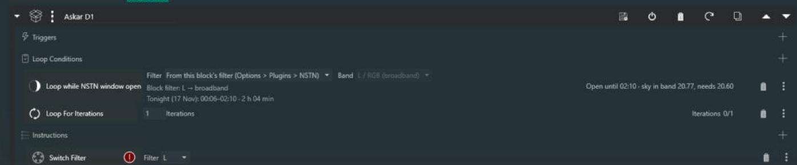

# NSTN für N.I.N.A.

Plugin für den Advanced Sequencer von N.I.N.A. 3.2: Die Bedingung
**„Loop while NSTN window open"** lässt einen Befehlsblock nur laufen, solange das
NSTN-Himmelsmodell das gewählte Band (L/RGB, Hα, O III, S II, Hβ) für das Ziel als
lohnend bewertet. Im Sequencer zeigt die Bedingung das Fenster der Nacht und den
aktuellen Zustand an.

Das Nachtmodell ist ein wörtlicher Port von FITSORAs `fitsora/domain/night.py`
(selbst ein Port des TypeScript-Belichtungsplaners) und wird gegen dieselben
Goldfixtures geprüft (`tests/Nstn.Core.Tests/golden/`).

## Aufbau

| Pfad | Inhalt |
|---|---|
| `src/Nstn.Core` | Nachtmodell, `WindowForecaster`, `PlanSimulator`, `FilterCatalog`, `FilterAssignments`, `NightInfo`, `SequenceCheck`, `Text` + `Strings/*.json` (Übersetzungen) (net8.0, keine NINA-/WPF-Abhängigkeit) |
| `tests/Nstn.Core.Tests` | Goldtests gegen `night_model.json`, Forecaster-, Simulator-, Katalog-, Night-Info-, Sequenzprüfungs- und Übersetzungstests (xUnit, net10.0) |
| `src/NINA.Plugin.Nstn` | NINA-Plugin (net8.0-windows, WPF, `NINA.Plugin` 3.2.0.9001) |
| `build.ps1` | Tests + Build im Docker-SDK-Container, legt `dist\NINA.Plugin.Nstn-<Version>.zip` an |

## Bauen

Voraussetzung: Docker mit `mcr.microsoft.com/dotnet/sdk:10.0`. Kein lokales .NET-SDK nötig.

```powershell
.\build.ps1
```

Ergebnis: `dist\NSTN\` mit genau drei DLLs (`NINA.Plugin.Nstn.dll`, `Nstn.Core.dll`,
`astronomy.dll`) und das ZIP darum.

## Installieren (manuell)

1. N.I.N.A. beenden.
2. Den Ordner `NSTN` aus dem ZIP nach `%LOCALAPPDATA%\NINA\Plugins\3.0.0\` entpacken
   (ergibt `...\Plugins\3.0.0\NSTN\*.dll`).
3. N.I.N.A. starten, unter *Options → Plugins → NSTN* den **SQM-Wert** des Standorts
   eintragen. Breite/Länge kommen aus dem Profil (*Options → General → Astrometry*).

## Benutzen

Die Bedingung gehört an einen Befehlsblock **innerhalb eines Ziel-Containers** (sie
braucht dessen Koordinaten). Geprüft wird vor jedem Befehl, auch in verschachtelten
Blöcken; eine laufende Belichtung wird zu Ende geführt, nie abgebrochen.

Muster für mehrere Filter (Rundlauf, Gewichtung über die Anzahl je Block):

```
Ziel NGC 7000
  Anfahren & Zentrieren
  Schleife – Loop Until Time: Morgendämmerung
    Wait for NSTN window
    Block OIII – Bedingungen: NSTN O III 7 nm + Loop For Iterations 1 → Smart Exposure 5 × 300 s OIII
    Block Hα   – Bedingungen: NSTN H-alpha 7 nm + Loop For Iterations 1 → Smart Exposure 5 × 300 s Ha
    Block SII  – Bedingungen: NSTN S II 7 nm + Loop For Iterations 1 → Smart Exposure 5 × 300 s SII
  Trigger: Autofokus, Meridian-Flip, Dithern
```

**Bedingungen an einem Block sind Schleifenbedingungen.** Hat ein Block nur die
NSTN-Bedingung, wiederholt N.I.N.A. ihn, solange sein Fenster offen ist: Er behält das
Fenster für sich (strikter Vorrang). Erst „Loop For Iterations 1" am Block macht daraus
einen Rundlauf, bei dem jeder Block pro Schleifendurchlauf einmal drankommt.

Ein Block, dessen Fenster zu ist, wird übersprungen. **„Wait for NSTN window" gehört an
den Anfang der Schleife:** Sind alle Fenster zu, würde N.I.N.A. 3.2 die Schleife sonst
ungebremst leer durchlaufen (eine Bremse von 250 ms je Durchlauf gibt es erst ab 3.3).
Der Befehl liest die Bänder aus den NSTN-Bedingungen der Blöcke darunter und wartet, bis
eines öffnet. Öffnet in dieser Nacht keines mehr, wartet er weiter, bis die
Schleifenbedingung (z. B. Morgendämmerung) die Schleife beendet.


## Filter-Voreinstellungen (ab 0.3.0)

Im Feld **Filter** der Bedingung stehen die Duo-Filter und Schmalband-Sätze aus den
NSTN-Tabellen (`src/Nstn.Core/Filters/*.csv`, unverändert aus `astro-public`). Mit einem
Filter zeigt **Band** nur dessen Linien, die Bandbreite kommt aus der Tabelle und ist
gesperrt; „Custom" erlaubt beides von Hand.

- Ein **Duo-Filter** startet auf seiner schwächeren Linie – der mit dem meisten
  Streulicht im Band (Bandbreite × Rayleigh-Gewicht), meist O III. Wählt man die
  robustere Linie, sagt ein Hinweis, dass der andere Kanal dann schon überstrahlt ist.
  Bei Farbkameras ist das eine legitime Wahl: zwei Blöcke, „solange O III offen" und
  „solange Hα offen", sammeln Hα länger (`samples/M31-NSTN-Duo.json`).
- Gespeichert werden Linie, Bandbreite **und** Filtername; Linie und Bandbreite bleiben
  maßgeblich. Beim Laden wird die gespeicherte Linie nie durch die Voreinstellung ersetzt,
  unabhängig von der Reihenfolge der Felder in der Datei.
- Die Tabellen sind ein Vorschlag: Askar verkauft einen D1 mit 6/6 nm und einen
  „Super D1" mit 8,5/6,5 nm. Nahe der Schwelle verschiebt 1 nm das Fenster deutlich
  (M 31 am 17.11.: O III 6 nm ab 22:18, 7 nm ab 23:56).

## Filter des Profils (ab 0.4.0)

Unter *Options → Plugins → NSTN → Filters of this profile* steht jeder Filter der
Filterradliste des Profils mit dem, was er durchlässt: „not assigned", „Broadband",
„Custom" (Linie + Bandbreite von Hand) oder ein Filter aus den NSTN-Tabellen. Gespeichert
wird je Profil.

- **Vorschläge** erscheinen neben jeder Zeile und werden nur per Knopf übernommen.
  Erkannt werden bekannte Produkte (Askar D1/D2/C1/C2, Optolong L-eNhance/L-eXtreme/
  L-Ultimate/L-Para/L-Synergy, SV220 mit Bandbreite), Breitbandnamen (L, R, G, B, Lum,
  kein_Filter, NoFilter, UV/IR) und einzelne Linien **mit** Bandbreite im Namen
  („Ha 3nm"). Keine Bandbreite wird erfunden: „Ha" allein, „Super D1" oder „ALP-T" bleiben
  ohne Vorschlag.
- In der Bedingung macht **Filter → „From this block's filter"** daraus die Quelle: Die
  Bedingung liest den Filter aus dem Switch Filter bzw. der Smart Exposure ihres Blocks
  und nimmt Band und Bandbreite aus der Zuordnung. Ändert man den Filter in der Smart
  Exposure, folgt die NSTN-Bedingung. Fehlt der Filter, nutzt der Block mehrere Filter
  oder ist der Filter nicht zugeordnet, meldet die Bedingung das als Problem.
- Für die Farbkamera mit Duo-Filter und zwei Blöcken (O III und Hα mit demselben Filter)
  passt diese Quelle nicht – dort den Filter direkt in der Bedingung wählen.

`samples/M31-NSTN-Block.json` braucht die Filter „Askar D1", „Ha" und „L" im Profil.



## Nachtplan (ab 0.2.0)

„Wait for NSTN window" zeigt unter sich, was die gebaute Struktur heute Nacht ab jetzt
voraussichtlich bringt: je Block das Fenster (blass), die Zeiten, in denen er belichten
würde (kräftig), Integrationszeit und Anzahl, dazu eine Zusammenfassung je Band und wann
und warum der Plan endet. Hinweise erscheinen darunter, etwa wenn ein Block ohne
Iterationsgrenze das Fenster für sich behält oder die äußere Schleife keine Bedingung hat
und deshalb nur einmal läuft.


Gerechnet wird nach den Regeln des Sequencers (Prüfung vor jeder Aufnahme, begonnene
Aufnahmen laufen zu Ende, Blockgrenze aus „Loop For Iterations", Ende aus „Loop For
Iterations" bzw. „Loop Until Time" der äußeren Schleife). Verschachtelte Reihen wie Smart
Exposure werden aufgelöst. Je Aufnahme kommt ein Zuschlag dazu (*Options → Plugins → NSTN*,
Standard 10 s); Autofokus, Meridian-Flip, Filterwechsel und Schwenks sind nicht enthalten.
Der Plan aktualisiert sich alle 20 s und per „Recalculate".

## Night Info (ab 0.5.0)

**„NSTN Night Info"** gehört an den Anfang eines Ziel-Containers. Der Befehl kostet beim
Ablauf keine Zeit (er schreibt nur eine Zusammenfassung ins Protokoll) und zeigt im
Sequencer:

- **Eckdaten der Nacht:** Sonnenuntergang/-aufgang, bürgerliche, nautische und
  astronomische Dämmerung, Dunkelzeit; Mondphase, Beleuchtung, Auf-/Untergang, mondfreie
  Dunkelzeit, nächster Voll- bzw. Neumond; Ziel: Kulmination, Zeit über der Mindesthöhe,
  nutzbare Zeit (davon mondfrei), Mondabstand über die nutzbare Zeit, dunkelster Himmel
  Richtung Ziel; die Fenster je Band; der Zustand jetzt.
- **Diagramm** von Sonnenuntergang − 30 min bis Sonnenaufgang + 30 min: Höhe von Ziel
  (durchgezogen) und Mond (gestrichelt) über der Dämmerung (heller = hellerer Himmel),
  Mindesthöhe, Kulmination; Mondabstand (0–180°); Himmelshelligkeit Richtung Ziel (V,
  16–22 mag) mit SQM-Linie; Zeile „Moon up" (Deckkraft nach Beleuchtung) und je Band die
  Fenster; Jetzt-Linie. Unter der Maus je 10 min: Uhrzeit, Zielhöhe und Luftmasse,
  Mondhöhe und -abstand, Himmel, Sonnenhöhe, offene Fenster.
- Die Bänder kommen aus den NSTN-Bedingungen unter dem Ziel; ohne Bedingung zeigt er
  L/RGB, Hα, O III, S II (je 7 nm).
- **Sequenzprüfung** des Ziel-Containers nach den Regeln, die N.I.N.A. tatsächlich anwendet –
  Warnungen (rot) und Hinweise:

  | Regel | Stufe |
  |---|---|
  | Schleife um die Blöcke ohne eigene Bedingung (läuft genau einmal) | Warnung |
  | Schleife ohne „Wait for NSTN window" (dreht in 3.2 ungebremst) | Warnung |
  | Warte-Befehl nicht an erster Stelle / innerhalb eines Blocks | Hinweis / Warnung |
  | Mehrere Blöcke, einer ohne „Loop For Iterations" (Vorrang statt Rundlauf) | Hinweis |
  | Block ohne Aufnahme | Warnung |
  | Filter im Block passt nicht zum Band der Bedingung (über die Profil-Zuordnung) | Warnung |
  | Eigene Probleme der Bedingung (kein SQM, Blockfilter fehlt/unbekannt …) | Warnung |
  | Fenster öffnet an diesem Standort nie / heute Nacht nicht | Warnung / Hinweis |
  | Aufnahmen in der Schleife außerhalb eines NSTN-Blocks | Hinweis |
  | NSTN-Bedingung direkt am Ziel-Container | Warnung |
  | Ziel kommt nicht über die Mindesthöhe bzw. nur außerhalb der Nacht | Warnung |
  | Kein Meridian-Flip-Trigger (Ziel, Zwischen-Container oder darüber), obwohl das Ziel in der nutzbaren Zeit kulminiert | Hinweis |

- **„How to build an NSTN sequence"** (aufklappbar, ebenso in der Plugin-Beschreibung):
  Baum des empfohlenen Aufbaus und sieben Regeln – Bedingungen sind Schleifenbedingungen,
  ein Block je Filter, „Loop For Iterations" für den Rundlauf, eigenes Ende der Schleife,
  Warte-Befehl zuerst, Trigger am Ziel, laufende Aufnahmen werden nie abgebrochen.

Aktualisiert wird alle 20 s (nur in der aktiven Sequenz) und per „Recalculate". Die Nacht
teilt sich den Zwischenspeicher mit den Bedingungen (`WindowForecaster.Night`), Fenster und
Anzeige können also nicht auseinanderlaufen.


## Sprache (ab 0.6.0)

Das Plugin spricht die Sprache von N.I.N.A. (*Optionen → Allgemein → Sprache*, je Profil):
**Englisch und Deutsch**, andere Sprachen fallen auf Englisch zurück. Ein Wechsel wirkt
sofort, ohne Neustart.

- Texte stehen je Sprache in `src/Nstn.Core/Strings/<sprache>.json` (eingebettet, keine
  Satelliten-DLLs – das Plugin bleibt drei DLLs). Eine neue Sprache = eine neue Datei mit
  denselben Schlüsseln.
- **N.I.N.A.s eigene Befehlsnamen** („Loop For Iterations“ / „Schleife für Iterationen“,
  „Meridian Flip“ / „Meridianflip“, Menüpfade) stehen als Platzhalter `{nina:…}` in den
  Texten und kommen zur Laufzeit aus N.I.N.A. – sie passen damit in jeder Sprache zu dem,
  was der Benutzer im Sequencer sieht. Deutsche Texte setzen deshalb keinen Artikel vor
  diese Namen.
- Zahlen und Datum im Format der Sprache (20,7 mag/arcsec², „17. Nov.“).
- Namen und Beschreibungen in der Befehlsliste: N.I.N.A.s Lader setzt sie einmal aus den
  englischen Export-Metadaten; das Plugin benennt sie in `Initialize()` und bei jedem
  Sprachwechsel um.
- Tests: gleiche Schlüssel und Platzhalter in allen Sprachen, jeder im Code benutzte
  Schlüssel vorhanden und jeder Eintrag benutzt (der Quelltext wird gelesen), die englische
  Anleitung in der Plugin-Beschreibung (`SequenceGuide.cs`, aus `en.json` erzeugt) gleich
  der im Sequencer.
- Englisch bleiben: Protokollzeilen (für die Fehlersuche) und die Plugin-Beschreibung im
  Plugin-Manager (Manifest).

## Beispiele

`samples/M31-NSTN-Test.json`: kurzer Testlauf für M 31 (3 Durchläufe, je Block höchstens
2 × 2 s). `samples/M31-NSTN-Plan.json`: eine Nacht im Rundlauf (O III und Hα je 5 × 300 s
pro Durchlauf, L/RGB absichtlich ohne Grenze) für den Nachtplan.
`samples/M31-NSTN-Duo.json`: Askar D1 an einer Farbkamera, je ein Block für O III und Hα. Alle Beispiele
beginnen mit „NSTN Night Info". In N.I.N.A. über
*Advanced Sequencer → Load sequence* laden; N.I.N.A. packt einen einzelnen Ziel-Container
selbst in eine neue Sequenz. Erzeugt werden die Dateien mit
`python samples/make_sample.py [full|plan|duo|block]` (`mistakes` erzeugt eine absichtlich
fehlerhafte Sequenz für die Sequenzprüfung) – wichtig für eigene Generatoren: jedes Element
braucht `"Parent": {"$ref": …}` auf seinen Container, sonst hat es nach dem Laden keinen
Elternteil und findet sein Ziel nicht.

## Getestet (17.11.2026, N.I.N.A. 3.2.0.9001, Simulator-Kamera)

| Prüfung | Ergebnis |
|---|---|
| Laden im Plugin-Manager, Optionsseite, Speichern im Profil | ok |
| Fensteranzeige gegen den Python-Port (M 31, 49,8° N, SQM 20,9) | identisch: Hα 18:48–03:44, O III 23:56–03:44, L/RGB ab 00:06 |
| Lauf mit Hα offen, O III und L/RGB zu | O III/L/RGB übersprungen, 6 Hα-Aufnahmen gespeichert |
| Alle Fenster zu, **ohne** Warte-Befehl | 1000 Leerdurchläufe in 0,56 s (N.I.N.A. 3.2 bremst nicht) |
| Alle Fenster zu, **mit** Warte-Befehl | wartet („O III opens 23:56"), 8 % eines Kerns (Leerlauf 2 %), Abbrechen ok |
| Anzeige-Refresh markiert die Sequenz nicht als geändert | ok |
| Nachtplan 0.2.0 (M31-NSTN-Plan.json ab 23:41) | O III 10 × 300 s, Hα 14 × 300 s, L/RGB 57 × 120 s, Ende 03:48; Vorrang-Hinweis bei L/RGB |
| Nachtplan nach Änderung der äußeren Schleife (1000 → 2) | per „Recalculate" und automatisch nach ≤ 20 s: Ende 03:02, „loop iterations used up" |
| Voreinstellungen 0.3.0 laden (M31-NSTN-Duo.json, beide Feldreihenfolgen) | Askar D1, O III bzw. Hα wie gespeichert, 6 nm gesperrt; Hinweis beim Hα-Block; Fenster = Python-Port (O III 6 nm 22:18–04:30, Hα 6 nm 18:36–04:30) |
| Filterwechsel in der Oberfläche (→ L-eXtreme 7 nm) | Band springt auf O III, 7 nm, Hinweis weg, Fenster 23:56–03:44 |
| Filter des Profils 0.4.0 (Askar D1, Ha, L angelegt) | Zeilen erscheinen, Vorschläge D1 → O III 6 nm und L → Breitband, „Ha" ohne Vorschlag; per Knopf übernommen, Ha von Hand Custom 7 nm; im Profil gespeichert |
| M31-NSTN-Block.json per `--sequencefile` | lädt, N.I.N.A. bleibt bedienbar; Block „Askar D1": „Block filter: Askar D1 → OIII 6 nm", Fenster 22:18–04:30; Nachtplan rechnet mit O III 6 nm / Hα 7 nm / L/RGB |
| Filter im Switch Filter umstellen (Askar D1 → Ha → L) | Band folgt in ≤ 30 s: H-alpha 656 nm, 7 nm, 18:48–03:44; dann L/RGB, 00:06–02:10 |

**Night Info 0.5.0 (18.11.2026, `--sequencefile`, M 31 bei 49,8° N, SQM 20,9):**

| Prüfung | Ergebnis |
|---|---|
| M31-NSTN-Plan.json | Eckdaten plausibel (Untergang 16:47, Dunkel 18:44–05:53, Mond 55 %, untergeht 00:02, Kulmination 21:30 bei 82°), Fenster = Bedingungen (Hα 18:48–03:44, O III 23:56–03:44, L/RGB 00:06–02:10); Prüfung: 2 Hinweise (L/RGB ohne Iterationsgrenze, kein Meridian-Flip-Trigger) |
| M31-NSTN-mistakes.json | 2 Warnungen (Block ohne Aufnahme, Schleife ohne Warte-Befehl), 4 Hinweise (2 × Vorrang, lose Aufnahme, Meridian-Flip) |
| Tooltip, Leitfaden aufklappen, Laden ohne Verklemmung | ok |
| Ausführen des Befehls im Sequenzlauf | **nicht geprüft** (nur Protokollzeile, kein Kamera-Lauf) |

**Übersetzung 0.6.0 (18.11.2026, Profil `de-DE` und `en-GB`):**

| Prüfung | Ergebnis |
|---|---|
| Start mit deutschem Profil (M31-NSTN-Plan.json) | Nachtinfo, Warte-Befehl, Nachtplan, Bedingung, Auswahllisten, Optionsseite auf Deutsch; „Schleife für Iterationen“, „Meridianflip“, „Optionen > Allgemein > Astrometrie“ aus N.I.N.A.; „17. Nov.“, „20,8 mag/arcsec²“ |
| Live-Wechsel Deutsch → Englisch → Deutsch | alle Plugin-Texte folgen ohne Neustart. Befund: Name der Bedingung und gewählter Eintrag der Filterauswahl blieben zunächst in der alten Sprache (N.I.N.A.s `SequenceCondition.Name` meldet keine Änderung, Auswahl-Einträge ohne Änderungsmeldung) – behoben |
| N.I.N.A.s eigene, schon geladene Befehle | behalten beim Live-Wechsel ihren alten Namen – Verhalten von N.I.N.A., nicht des Plugins |

**Zwei Fehler aus dem Test vom 17.11., in 0.4.0 behoben:**

- *Verklemmung beim Laden einer Sequenz im Block-Modus.* N.I.N.A. 3.2 schützt alle
  Container mit **einer statischen Sperre** und ruft `Validate()` der Elemente unter dieser
  Sperre auf; der Warte-Befehl fragt dabei die Bedingung. Die Bedingung las im
  Hintergrund-Refresh die Elemente ihres Blocks (`GetItemsSnapshot`, nimmt die
  Container-Sperre) **innerhalb** ihrer eigenen Sperre – überkreuzte Sperrreihenfolge.
  Folge: N.I.N.A. nahm keine Eingaben mehr an, meldete sich aber als „Responding" (ein
  wartender STA-Thread pumpt nur noch einen Teil der Nachrichten). Jetzt wird alles aus den
  Containern **vor** der eigenen Sperre gelesen.
- *Leere Bandauswahl nach Filterwechsel.* Die Bandliste war bei jedem Abruf eine neue
  Liste; eine WPF-ComboBox setzt dann ihre Auswahl zurück. Jetzt gibt es je Katalogfilter
  genau eine Liste, im Block-Modus immer die vollständige.

0.1.1 behebt einen Befund aus diesem Test: 0.1.0 schrieb bei Leerdurchläufen je
Bedingung und Prüfung eine Protokollzeile (2000 Zeilen je 1000 Durchläufe); jetzt nur bei
einem echten Zustandswechsel. N.I.N.A. selbst schreibt weiter 4 Zeilen je übersprungenem
Block – ein Grund mehr für den Warte-Befehl.

## Bekannte Grenzen (Stand 0.6.0)

- „From this block's filter" folgt einem Filterwechsel mit bis zu 30 s Verzögerung
  (Aktualisierungstakt), entschieden wird beim Prüfen vor jeder Aufnahme aber aktuell.
- Umbenennen eines Filters im Profil wird erst nach „Reload filter list" oder erneutem
  Öffnen sichtbar; neue/gelöschte Filter sofort.
- Nachtplan: nur die Blöcke direkt unter dem Warte-Befehl; andere Schleifenbedingungen als
  „Loop For Iterations"/„Loop Until Time" werden genannt, aber nicht gerechnet; nur die
  laufende Nacht.
- Night Info: Sequenzprüfung nur innerhalb des eigenen Ziel-Containers (Trigger darüber
  zählen für den Meridian-Flip); Montierungstyp unbekannt, deshalb ist der fehlende Flip nur
  ein Hinweis. Nur die laufende Nacht.
- Übersetzt nur Englisch und Deutsch; die Plugin-Beschreibung im Plugin-Manager bleibt englisch.
- Uhrzeiten in der lokalen Zeit des Aufnahme-PCs.
- Getestet nur mit der Simulator-Kamera, ohne Montierung, Filterrad, Guiding und
  Meridian-Flip.
